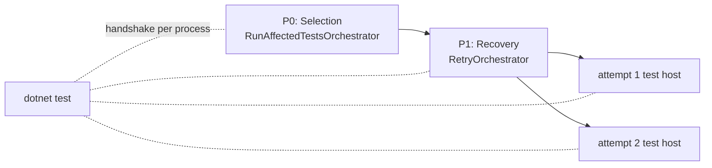

# Multiple test orchestrators: research and decisions

Status: implemented for opt-in orchestrators in MTP 3.x, including Retry.
Distribution and Repetition are extension points, not new built-in orchestrators.
Adoption by the independently shipped AffectedTests extension is not part of this change.

## Problem and contract

### User outcome

A test application with more than one enabled `ITestHostExecutionOrchestrator`
should run as one deterministic invocation instead of crashing. Example:
`--affected-tests` together with `--retry-failed-tests`, or local shard fan-out
combined with retry. Extension authors need a documented contract that covers
ordering, exit codes, cancellation, artifacts, and the `dotnet test` handshake.

### Behavior before composition

Source state: `be3cf477a83f9b94e416b0401163a48580e389aa`.

- The limit applies to *enabled* orchestrators, not registered ones. Any number
  of factories can be registered. `ExtensionBuilderHelper` builds them, checks
  that Uids are unique, and keeps only those whose `IsEnabledAsync()` returns
  `true`. Retry is enabled only by `--retry-failed-tests`
  (`RetryOrchestrator.cs:38-39`).
- Mode selection prefers the orchestrator host over the test host controllers
  and the test host. It skips the orchestrator host when nothing is enabled or
  when `--list-tests` is set (`TestHostBuilder.Modes.cs:96-100,126-139`).
- When two orchestrators are enabled, `TestHostOrchestratorHost.RunAsync`
  throws the unlocalized `NotSupportedException("Multiple test orchestrator not
  supported")`. The throw happens after the process role has been set and the
  orchestrator lifetimes have been built (`TestHostOchestratorHost.cs:26-31`).
- Middleware (#11607) requires exactly one enabled orchestrator
  (`TestHostBuilder.Modes.cs:141-143,169-178`). Its documentation defers "a
  typed, multi-run orchestration model (for example a first-class
  retry/stress/shard engine)" and states that Retry "is not reentrant"
  (`ITestHostExecutionOrchestratorMiddleware.cs:10-20`).

### Confirmed requirement

Enable several registered orchestrators to participate in one invocation
without silently dropping a requested behavior. Keep the existing standalone
contract for extensions that do not opt in.

### Assumptions

These were the assumptions at design time; executed checks are recorded below.

- **A1:** The motivating combinations are an orchestrator that narrows or
  reshapes the work (affected-test selection, local shard fan-out, or
  stress/repeat) paired with Retry. No scenario needs two recovery
  orchestrators.
- **A2:** A standalone orchestrator's child is the same executable, so it must
  already remove its own activation from the child command line to avoid
  recursion. Retry does this (`RetryArgumentsBuilder.cs:33-47`). The
  `Microsoft.Testing.Extensions.AffectedTests` orchestrators ship outside this
  repository, so this record assumes they do the same without having verified
  it.
- **A3:** `dotnet test` accepts several orchestrator handshakes for one module
  when they come from different processes. This is based on code reading only;
  see the research entry below.
- **A4:** The target is the experimental (`TPEXP`) surface in MTP 3.x, with no
  break to shipped API.
- **A5:** It is unknown whether users already try to combine
  `--affected-tests` with `--retry-failed-tests`.

### Constraints

- When exactly one orchestrator is enabled during normal execution, behavior
  must not change: the process tree, handshake properties, exit codes,
  artifacts, and telemetry stay identical. Discovery is an intentional
  exception, described below.
- Handshake property ID 11 `OrchestratorFeature` is an exact-match contract with
  dotnet/sdk (see research). Changing its meaning is a cross-repository break.
- Repository API rules apply: new public API must be experimental and carry the
  experimental remark, must not use `init` accessors, and must be listed in
  `PublicAPI.Unshipped.txt`. Errors must be localized through RESX.

### Non-goals

- Shipping new selection, distribution, or repetition extensions.
- Turning Retry into middleware, or moving Retry's engine into the platform.
- Orchestration in IDE or JSON-RPC server mode. Retry already rejects server
  mode unless the `dotnet test` pipe is in use.
- Composing orchestrators under `--list-tests`.
- A general workflow or DAG engine.

### Affected consumers

| Consumer | Current dependency |
| --- | --- |
| `dotnet test` (`TestApplicationHandler` in dotnet/sdk) | One handshake per process. Exact ID 11 Uid matches. `AttemptNumber` (ID 13). |
| Terminal output | The orchestrator process role and Retry's attempt summaries. |
| Orchestrator lifetimes | `AzureDevOpsTestRunOrchestratorLifetime` creates one Azure DevOps run. `MSBuildOrchestratorLifetime` sends module information. |
| Middleware | Wraps exactly one orchestrator invocation. |
| Results and artifacts | Retry's per-attempt folders, TRX/JUnit/CTRF consolidation, and deferred TRX publication. |
| `ITestHostLauncher` (RFC 017) | Retry launches each attempt through it when a launcher is registered. |
| External orchestrators | `RunAffectedTestsOrchestrator` and `RefreshMappingsOrchestrator`. |
| Telemetry | One `TestHostOrchestratorHost` activity per process. |

### Contract to define

The design must answer each of the following:

- Activation and ordering.
- What an orchestrator's child process is.
- How exit codes are aggregated.
- How cancellation propagates.
- Where lifetimes and middleware run.
- What each process sends in the handshake.
- Who owns the results directory and artifacts.
- Attempt, shard, and iteration identity.
- Deterministic failures for combinations that cannot be supported.
- Compatibility with existing orchestrators and with older SDKs.

## Research and experiments

The initial design entries are based on code and document reading at the
stated source states. The implementation validation below distinguishes
executed scenarios from proposed follow-up work.

### 2026-11-23: orchestrator host and builder

- `TestHostOrchestratorHost` handshakes from the orchestrator process with
  `HostType=TestHostOrchestrator` and `OrchestratorFeature=<orchestrator Uid>`
  (`TestHostOchestratorHost.cs:39-64`). It then runs every lifetime's
  `BeforeRunAsync`, runs the orchestrator directly or through middleware, maps
  cancellation to `TestSessionAborted`, and runs `AfterRunAsync` and disposal
  with error isolation (lines 71-154). Lifetimes therefore bracket the whole
  orchestration exactly once per orchestrator process.
- Launcher authorization (`ITestHostControllerConnectionAuthorizationConsumer`)
  is resolved when any enabled orchestrator implements the marker
  (`TestHostBuilder.Modes.cs:146-157`).
- Effect on the design: per-process concerns (handshake, lifetimes, middleware,
  authorization) are bound to a single active orchestrator. A design that keeps
  one active orchestrator per process can reuse all of them unchanged.

### 2026-11-23: Retry as the reference orchestrator

- Retry owns the whole attempt loop:
  - Launching the child, and building its command line.
  - The per-attempt results folders.
  - Environment variables: the TRX test-run id; the logical-run id, which is
    kept when "supplied by the outer launcher"; and
    `TESTINGPLATFORM_DOTNETTEST_ATTEMPTNUMBER`.
  - The failed-test pipe from the child test host (`RetryFailedTestsPipeServer`).
  - Killing the child on cancellation.
  - Report consolidation, and the final exit code.
- The recursion guard is command-line stripping. `ComputeIndicesToCleanup`
  removes `--retry-failed-tests`, the Retry options that depend on it, and
  `--results-directory`. It throws `Unreachable` when the activation option is
  missing from the raw arguments (`RetryArgumentsBuilder.cs:33-47`).
- Later attempts remove `--treenode-filter`, `--filter-uid`, and
  `--minimum-expected-tests`, then add a response file with the failed UIDs
  (`RetryArgumentsBuilder.cs:240-247`). `--partition` is kept, so a partitioned
  run retries within its own partition (`test-partitioning.md:119-130`).
- Retry launches attempts through `ITestHostLauncher` when one is registered.
  That launcher can target a device or a remote host.
- Effect on the design: Retry needs per-test IPC from its *direct* child test
  host, and its child may not be a local process. It can only be the
  orchestrator closest to the test host.

### 2026-11-23: existing nesting awareness

- `AzureDevOpsTestRunOrchestratorLifetime` leaves a run alone when it inherits
  the run id, because "an ancestor process owns the run (e.g. nested
  orchestrators)".
- Retry keeps a logical-run id supplied by an outer launcher.
- `MSBuildOrchestratorLifetime.BeforeRunAsync` connects to the MSBuild pipe and
  sends `ModuleInfoRequest`. Test hosts send it too, so the MSBuild side already
  receives more than one connection per module.
- Effect on the design: environment inheritance across process layers is an
  established pattern. Running lifetimes only in the outermost process avoids
  duplicate Azure DevOps lease work and duplicate MSBuild messages.

### 2026-11-23: `dotnet test` handshake consumer

Source state: dotnet/sdk `0a544cdef4893f75b9a44d0567258b890e79b15c`,
`src/Cli/dotnet/Commands/Test/MTP/TestApplicationHandler.cs`.

- Line 191: when an orchestrator handshake carries
  `OrchestratorFeature == "RetryOrchestrator"`, the SDK renders attempt 1 as a
  retry attempt.
- Lines 198-203: any other orchestrator handshake marks the module as an
  incomplete handshake, unless its Uid is `RefreshMappingsOrchestrator` or
  `RunAffectedTestsOrchestrator` and the matching SDK mode is active. Lines
  853-858 accept a completion with no test host only after one of those
  recognized handshakes.
- The flags accumulate with `|=`, and a later test-host handshake completes the
  module through `AssemblyRunCompleted`.
- Effect on the design: one process that reports a single ID 11 value cannot
  describe a chain. Reporting Retry loses the affected-tests acceptance of a
  run with zero selected tests. Reporting the affected-tests Uid loses retry
  rendering. One handshake per orchestrator process, each carrying its own Uid,
  matches what the SDK already accumulates (assumption A3; not executed).

### 2026-11-23: prior design records

- RFC 017 (`docs/RFCs/017-TestHost-Launcher.md:489-499`) keeps the orchestrator
  as "the right tool for whole-run concerns (e.g. retry/repeat that re-runs the
  host)" and introduces a separate launcher hook.
- RFC 020 (`docs/RFCs/020-Test-Execution-Filter-Providers.md:60-84`) leaves
  planning, sharding, and retry scheduling with an orchestrator.
- `docs/decisions/test-partitioning.md:119-170` keeps Retry as the sole
  orchestrator with `--partition`. It excludes nested-orchestrator composition
  and leaves the
  [MTPSharding prototype](https://github.com/Youssef1313/MTPSharding/blob/398ba09ebbdf4da4136230cb595644034d3b62f0/docs/Design.md)
  as a valid candidate.
- Protocol 004 (`docs/mstest-runner-protocol/004-protocol-dotnet-test-pipe.md`)
  has several relevant points:
  - Property ID 13 says "Multiple Instance IDs may share one attempt" (line
    441).
  - The multi-process section says an orchestrator "drives one or more test host
    executions" (lines 800-801).
  - ID 19 sets the precedent for an additive capability that the SDK reports
    only in its reply.

## Alternatives and decision

| Option | Summary | Main tradeoff | Verdict |
| --- | --- | --- | --- |
| A. No change | Keep one enabled orchestrator, plus middleware. | No risk, but the run crashes late with an unlocalized error, and selection cannot be combined with retry. | Rejected as the end state. |
| B. Deterministic rejection | Fail at build time with a localized error that names the enabled Uids. | Small and shippable on its own, but it does not enable composition. | **Phase 1.** Also the fallback for any combination that cannot be composed. |
| C. Selection policy | First enabled wins, or highest priority wins. | Silently drops behavior the user asked for (for example, retry is ignored), which gives false confidence. | Rejected. |
| D. Sequential | Run each orchestrator in turn over the full suite. | Every orchestrator reruns everything, so the verdict is meaningless and the duration multiplies. | Rejected. |
| E. Middleware v2 | Allow `next` to be called more than once. | `next(CancellationToken) -> int` cannot change arguments, filters, or results folders. It would also reverse the v1 contract. | Rejected. |
| F. In-process typed composition | Each orchestrator receives an `inner.RunAsync(request) -> result` delegate. | One process, typed results, and global retry across shards become possible. It needs a large public API, a generic per-test result channel in the platform, and rewrites of Retry and AffectedTests. | Deferred; see the triggers below. |
| G. Process nesting ordered by registration | Activate the first registered orchestrator; its child activates the next one. | No new API, but semantics follow generated registration and package order. Retry could end up as an outer layer and lose the IPC it needs. | Rejected. |
| H. Process nesting ordered by stage | Like G, but each orchestrator declares a stage, and the stage fixes the order. | One small API. It costs one extra process per child launch of each outer stage, and outer stages see only exit codes and artifacts. | **Phase 2.** |

### Phase 1: deterministic rejection

Move the check from `TestHostOrchestratorHost.RunAsync` into
`TryBuildTestHostOrchestratorHostAsync`, next to the middleware validation. The
check then runs before the process role is set, before lifetimes are built, and
before the handshake. Throw a localized error that lists the enabled
orchestrator Uids in registration order, for example:

> Multiple test host orchestrators are enabled ('RetryOrchestrator',
> 'RunAffectedTestsOrchestrator'). Only one orchestrator can run per invocation.

The error uses the same failure path as the existing middleware validation.
After Phase 2, the same validation covers combinations that cannot be composed.
Because this change affects only a path that fails today (the exception type and
message change), it can ship independently.

### Phase 2: process nesting ordered by stage

**Core rule.** Each process activates at most one orchestrator: the enabled one
with the outermost stage. Its children are launches of the same test
application. In a child process, the outer orchestrator is no longer enabled,
so the child activates the next stage. The innermost stage's child has no
enabled orchestrator, so it becomes the test host controller or the test host,
exactly as Retry's children do today.



With local shard fan-out, P0 would be a `Distribution` orchestrator. It would
launch one Retry process per shard, and each shard would retry its own failures.

**Experimental API** (MTP, `PublicAPI.Unshipped.txt`). Both types carry
the experimental remark, and no `init` accessors are used:

```csharp
[Experimental("TPEXP", UrlFormat = "https://aka.ms/testingplatform/diagnostics#{0}")]
public enum TestHostExecutionOrchestratorStage
{
    Selection = 100,
    Distribution = 200,
    Repetition = 300,
    Recovery = 400,
}

[Experimental("TPEXP", UrlFormat = "https://aka.ms/testingplatform/diagnostics#{0}")]
public interface IComposableTestHostExecutionOrchestrator : ITestHostExecutionOrchestrator
{
    TestHostExecutionOrchestratorStage Stage { get; }
}
```

The gaps between values leave room to insert stages later. Stage order runs from
outermost to innermost:

| Stage | Meaning | What it needs from its child | Example |
| --- | --- | --- | --- |
| `Selection` | Chooses the tests once for the whole invocation. | Exit code and artifacts. | `RunAffectedTestsOrchestrator` |
| `Distribution` | Splits the selected work across several child invocations. | Exit codes. | Local shard fan-out (MTPSharding) |
| `Repetition` | Runs the same work several times. | Exit codes. | Stress or repeat |
| `Recovery` | Reruns failures. Must be adjacent to the test host. | Per-test IPC. | `RetryOrchestrator` |

Why this order:

- Shards partition only the tests that were selected.
- Each shard retries its own failures, which matches
  `--partition i/n --retry-failed-tests k`.
- Each repetition retries its own flaky failures, so iterations are never
  reported as retry attempts.
- Recovery stays innermost because Retry needs IPC from its test host and may
  launch it through `ITestHostLauncher` on a device or remote target, where an
  orchestrator process cannot run.

**Composition rules.** Every process validates these at build time, before the
handshake. A violation produces a Phase 1 style error that names the Uids
involved.

1. One enabled orchestrator during normal execution: behavior is unchanged, and
   the stage is ignored. Discovery is the intentional exception described in
   rule 5.
2. More than one enabled orchestrator: each one must implement
   `IComposableTestHostExecutionOrchestrator`.
3. At most one orchestrator per stage. Ordering therefore never depends on
   registration order, which comes from generated self-registration and package
   references rather than from user intent.
4. Each member's existing environment rejections still apply. For example,
   Retry rejects hot reload and server mode without the `dotnet test` pipe. If
   any member rejects the environment, the whole combination fails.
5. `--list-tests` bypasses orchestration before orchestrator factories are
   created or enablement is queried, and before orchestrators are initialized
   or middleware is built. This applies even when only one orchestrator is
   registered. It intentionally changes discovery behavior from before this
   change, when enabled orchestrators and middleware were initialized during
   discovery; the change avoids initializing execution components for test
   listing.
6. `Repetition` and `Recovery` cannot be composed under the `dotnettestcli`
   named-pipe protocol. When an iteration retries, the next iteration starts
   again at attempt 1 for the same execution and test UID. The SDK progress
   consumer requires non-decreasing attempt numbers
   ([`TestProgressState`](https://github.com/dotnet/sdk/blob/5db7f0f18d18c99acfa82e6663a84b1122195380/src/Cli/dotnet/Commands/Test/MTP/Terminal/TestProgressState.cs#L343)).
   Reject this combination until iteration identity is represented in the
   protocol. Other protocols are not restricted by this check.

**Child-launch contract for every stage except the innermost:**

- Launch the current executable locally, not through `ITestHostLauncher`.
- Let the child inherit the environment.
- Forward every argument the stage does not own. This includes inner-stage
  options such as `--retry-failed-tests` and `--partition`, as well as the
  `dotnet test` server and pipe arguments.
- Remove the stage's own activation options (A2).
- A stage may add filter or partition arguments. It must give each child a
  distinct `--results-directory` under its own results directory.
- Do not set Retry-owned variables: the attempt number, or the deferred TRX
  variables.
- The extension owns its launch and teardown. A shared launcher or aggregation
  helper can be evaluated when a second production extension needs one.

**Internal chain guard (not public API).** When composition is active, the
platform sets an internal environment variable before running the active
orchestrator. The variable holds the ordered list of consumed Uids. It is
process-wide, so every child process started while the orchestrator is running
inherits it, not only the intended child that continues the composition. This
includes diagnostic/helper processes and custom launcher targets. An MTP process
consumes and clears it at startup before skipping the listed Uids; unrelated
launches must remove it if they must not continue the composition. If a test
host controller must restart an attempt, it forwards the chain explicitly in
the child's launch environment. Test code in the normal MTP test process does
not inherit it because MTP startup has already cleared it. The guard has three
uses:

- It prevents re-activation, even when an orchestrator was enabled by
  configuration rather than by a command-line option it can strip.
- It tells the platform whether the current process is the outermost one.
- It is never set when only one orchestrator is enabled, so single-orchestrator
  behavior stays identical.

If an orchestrator both clears the child environment and fails to strip its own
activation, the child re-activates it and recurses. That failure already exists
today for any standalone orchestrator, so this design does not introduce it.

**Where process-wide extensions run.** Orchestrator lifetimes and middleware run
only in the outermost orchestrator process. Inner processes inherit the
environment those extensions publish, such as the Azure DevOps run id and the
result-map path. Middleware validation changes from "exactly one enabled
orchestrator" to "exactly one active orchestrator in this process". Launcher
authorization is resolved for the active orchestrator only. In practice that is
Retry's process, which matches today's behavior.

**Exit codes:**

- Every process returns its active orchestrator's exit code, and the outermost
  process's exit code is the invocation result.
- `Selection` returns its child's exit code, or its own result when it selects
  nothing and launches no child. That process handshakes with its own Uid, so
  the SDK's acceptance of a run with zero selected tests keeps working.
- `Distribution` and `Repetition` aggregate their children's exit codes. The
  proposed rule:
  - Cancellation returns `TestSessionAborted` (3).
  - Otherwise, if any child failed, return the failure with the highest
    precedence. Proposed precedence: 3 > 7/11 > 1 > 4/5/10/12 > 2 > 9/13/14/15.
  - All children `ZeroTests` (8) returns `ZeroTests`.
  - A mix of `Success` and `ZeroTests` returns `Success`, because an empty shard
    is legitimate.
  - A shared platform helper keeps every stage consistent.
- `Recovery` keeps Retry's semantics unchanged.

**Cancellation.** Each process keeps its root application token. Today's
orchestrator host already starts the `dotnet test` server-control channel in
each orchestrator process that supports it. On cancellation, an outer stage
stops launching children and kills the process trees of running children, with
a bounded wait as Retry does. The cancellation surfaces as
`TestSessionAborted`, consistent with `TestHostOchestratorHost.cs:84-89`.

**Handshake.** Each orchestrator process sends its own handshake, with
`HostType=TestHostOrchestrator` and ID 11 set to its own Uid. The Selection +
Retry run below required no protocol change in either released SDK tested.
Retry processes for different shards can be on different attempt
numbers at the same time. The protocol already allows multiple instances per
attempt, but how the SDK renders that is not yet proven.

**Artifacts and output:**

- Each stage owns its results directory, and each child gets a subdirectory.
- Retry keeps consolidating its own attempts.
- Merging reports across shards is an open question.
- A `Distribution` stage that runs children in parallel owns how their console
  output is captured or prefixed. It must not interleave partial lines.

**Telemetry.** There is one `TestHostOrchestratorHost` activity per process.
Trace-context propagation across processes has not been verified (open
question).

**Cost.** One extra process per child launch of each outer stage:

- Selection plus Recovery: one extra process.
- Distribution with `n` shards plus Recovery: `n` extra processes.
- Repetition with `k` iterations plus Recovery: `k` extra processes.

Each of these processes repeats platform initialization.

**Implementation:** `TestHostOrchestratorManager` validates the enabled set and
selects the active stage before initializing composable orchestrators.
`TestHostBuilder` consumes the chain and bypasses orchestration during
discovery, including factory creation and enablement checks for single-
orchestrator runs.
`TestHostOrchestratorHost` publishes the child chain only around the selected
orchestrator's execution, not around lifetime callbacks or short-circuiting
middleware. Each extension remains responsible for its exit code and artifacts;
the platform does not implement the proposed fan-out aggregation policy.

### Phase 3 (conditional)

- Add handshake properties, such as orchestrator depth or shard and iteration
  identity, only if an end-to-end test shows the SDK needs them. If behavior
  must be gated on SDK support, use an SDK reply capability following the ID 19
  pattern.
- Move to option F behind the same stage contract only when one of these
  triggers is demonstrated:
  - The extra-process overhead is a material share of wall time for real
    repetition or distribution workloads.
  - An outer stage needs per-test results, for example global retry across
    shards.
  - Composition is required in IDE or server mode.
  - dotnet/sdk cannot accept several orchestrator handshakes per module.

## Validation and demonstration

The release pack and focused unit/acceptance runs use the repository-pinned
SDK. The generated `DotnetTestPipeOrchestratorHandshake` app references
`Microsoft.Testing.Platform` and `Microsoft.Testing.Extensions.Retry`
(`3.0.0-dev`); the outer acceptance runner is not the package consumer.

### Executed on Windows x64, 2026-11-24

| Boundary | Observation |
| --- | --- |
| Selection and lifecycle | 93 focused manager, builder and host cases passed on each of `net10.0`, `net11.0` and `net462`. These include discovery with incompatible orchestrators, pre-enablement duplicate-Uid rejection, stage ordering and selected-only initialization. |
| Wire and restart | `DotnetTestPipe_Orchestrator_HandshakesWithFeature` and both rows of `DotnetTestPipe_ComposedOrchestrators_EachProcessHandshakesWithItsUid` passed. The composed rows check both feature Uids, one execution id, distinct instance ids, and attempts 1 and 2, with zero or two controller handshakes respectively. |
| Counterfactual | With the original composition implementation, the direct row and Retry alone passed; the controller row failed: `The child reactivated the consumed Selection orchestrator.` The controller had dropped the consumed chain on relaunch. The same three cases passed after the fix (suite exit 2 → 0). This isolates a restart regression, not every aspect of composition. |
| Repetition with Recovery | The packed `DotnetTestPipe_RepetitionAndRecoveryOrchestrators_AreRejectedBeforeExecution` case uses a two-iteration fixture whose first test attempt fails and retries. With the pipe-mode guard removed, both the fake named-pipe consumer and SDK `11.0.100` observed the attempt reset `[1, 2, 1]`; the SDK terminated with `UnreachableException: Unexpected test result for attempt '1' while the last attempt is '2'` (exit `-2146232797`). With the guard, the packed acceptance case passed without a test-host handshake. The real-SDK run is the unguarded counterfactual; the guard path itself is verified by the packed fake named-pipe test. |
| Released SDKs | SDKs `10.0.404` and `11.0.100` each ran the packaged `net11.0` apphost with Selection, Retry and a controller restart. Both reported `FlakyTest` failed on try 1, passed on try 2, and returned 0 for one logical test. SDK 11 also reported `flaky: 1 (passed after retry)`. |
| Mixed modules | SDK `11.0.100` ran the pre-fix and fixed apphosts in one invocation. The fixed module passed after retry, the previous module failed at its controller child, and the SDK returned 1. |

The generated project's `project.assets.json` resolved `lib/net11.0` for both
packages. SHA-256 comparisons matched the actual apphost-directory DLLs to
the corresponding NUPKG entries in both the red and green runs:

| Release NUPKG | Pre-fix SHA-256 | Fixed SHA-256 |
| --- | --- | --- |
| `Microsoft.Testing.Platform.3.0.0-dev` | `D8CC9D273F2BC730A1A79E5E83C304AB6F3AD2BD80E486FBE161B8B0C4A96E6B` | `4D2365A4BC3431B2036CA88B42B8CBC954CC2B60EDA0603696D746B4DD2424A1` |
| `Microsoft.Testing.Extensions.Retry.3.0.0-dev` | `F2173BB1CDB11FDC088850245CCE5E2EB5D9D8DCE16E58485B8CD34EE742DBBC` | `C164E843F0063755C7F77A3A1A0B14EE0AD8F0DE9EFD759AA9C7F3EF2772C556` |

Reproduce the packed assertions from the repository root:

```powershell
.\build.cmd -pack -c Release -bl
$project = 'test\IntegrationTests\Microsoft.Testing.Platform.Acceptance.IntegrationTests\Microsoft.Testing.Platform.Acceptance.IntegrationTests.csproj'
.\.dotnet\dotnet.exe test --project $project -c Release --no-build --no-restore -p:UsingDotNetTest=true -- --filter 'FullyQualifiedName~DotnetTestPipeOrchestratorHandshakeTests' --show-test-results all
```

### Remaining coverage and rollout

The original coverage plan below also covers future extensions. It is not a
claim that every proposed scenario has shipped or been executed.

| Requirement / risk | Planned automated E2E evidence | Rendered check / gap |
| --- | --- | --- |
| Phase 1 rejection | MTP acceptance test with two enabled fake orchestrators. Assert the localized message names both Uids, assert the exit code, and assert that no child process starts. Run directly and under `dotnet test`. | Terminal error text with ANSI and without ANSI. |
| Single orchestrator unchanged | Existing Retry acceptance tests pass before and after (green/green). Handshake properties are identical. | Retry summary transcript is unchanged. |
| Selection with Recovery | A Selection test asset plus Retry, with one flaky test inside the selected set. Assert exit 0, that attempt 2 runs only the failed UID, the handshake order, and the retry rendering in the SDK. | Terminal at 80 and 200 columns. The zero-selected path needs the real AffectedTests package, because the SDK recognizes only its Uids. |
| Distribution with Recovery | A two-shard test asset with `--partition` and a flaky test in shard 1. Assert per-shard retry, distinct results directories and instance ids, attempt numbers, and the aggregated exit code. | No interleaved partial lines. SDK rendering of concurrent attempts remains a gap until it is run. |
| Composition rules | Two orchestrators in the same stage, and an undeclared orchestrator combined with another. Assert errors that name the Uids. | Error text. |
| Repetition with Recovery | The `dotnettestcli` pipe rejects Repetition + Recovery before any test-host handshake. The packed two-iteration counterfactual without the guard was run against SDK `11.0.100` and terminated on `[1, 2, 1]`; the guarded acceptance case verifies rejection before test-host execution. | No rendered change. The real-SDK run was the unguarded failure reproduction; the guarded path was validated with the packed fake named-pipe consumer, not a released SDK executable. |
| Cancellation | Cancel during an inner attempt. Assert exit 3 in every process and no orphaned process ids. | Nonvisual. |
| Lifetimes and middleware run once | Azure DevOps loopback publisher sees exactly one run created and finalized. A middleware marker file is written once. | The payload is proven; the live Azure DevOps UI remains a gap. |
| Recursion guard | An outer orchestrator that does not strip its option. Assert the process count is bounded. | Nonvisual. |
| Exit-code aggregation | Unit tests for the shared helper's precedence table. | Nonvisual. |

## Open questions

1. Sequential orchestration handshakes work with the released SDKs above.
   Concurrent per-shard attempts and any need for Phase 3 properties remain open.
2. AffectedTests owners: will they adopt `IComposableTestHostExecutionOrchestrator`
   and confirm argument stripping (A2)? Do they launch through
   `ITestHostLauncher`? Which stage fits `RefreshMappingsOrchestrator`, or
   should it reject composition?
3. Is a closed stage set sufficient, or do third parties need custom stages?
4. What is the final exit-code precedence, and should the aggregation helper be
   public?
5. Should a `Distribution` stage merge reports across shards, or keep them
   nested?
6. Should trace context propagate across orchestrator processes?
7. How does this interact with deadline-aware cancellation (#10018), for
   example when passing the remaining budget to inner processes?
8. Release and servicing: should Phase 1 be serviced to 2.x? It changes only a
   path that fails today. Who owns the rollout through dotnet/sdk and
   AffectedTests? This is not yet assigned.
